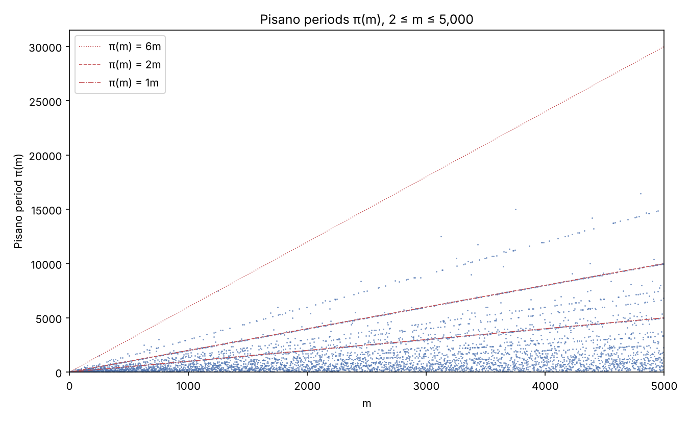

# Pisano periods π(m), 2 ≤ m ≤ 5,000

Convention: F_1 = F_2 = 1. π(m) is the least k > 0 with (F_k, F_{k+1}) ≡ (0, 1) (mod m), computed by iterating the pair from (0, 1). Every number below is read from `pisano_results.json`.

## Checks

- Pisano tests (`pytest tests/test_pisano.py`): **324 passed, 0 failed** (`324 passed in 0.19s`).
- Full suite (`pytest tests`, including the Wall–Sun–Sun tests): **554 passed, 0 failed** (`554 passed in 54.04s`).
- Anchors: π(2) = 3, π(3) = 8, π(5) = 20, π(7) = 16, π(10) = 60, π(11) = 10, π(100) = 300, π(1000) = 1500: all hold.

## Part 1: the table

- π(m) computed for all 4999 values of m from 2 to 5000; the full table is under `table` in `pisano_results.json`.
- π(m) even for every m > 2: checked 4998 values, **0 exceptions**.

## Part 2: the picture



| | π(m)/m | m | π(m) |
|---|---:|---|---|
| largest ratio | 6/1 = 6 | 10, 50, 250, 1250 | 60, 300, 1500, 7500 |
| smallest ratio | 34/3571 ≈ 0.009521 | 3571 | 34 |

## Part 3: lifting from p to p²

For each of the 95 primes p ≤ 500, π(p²) was compared with p·π(p). Exceptions: **0**.
A prime with π(p²) ≠ p·π(p) would be of Wall–Sun–Sun type. This agrees with the earlier search, which found no Wall–Sun–Sun prime below 10⁷.

| p | π(p) | π(p²) | p·π(p) | lifts |
|---:|---:|---:|---:|:---:|
| 2 | 3 | 6 | 6 | yes |
| 3 | 8 | 24 | 24 | yes |
| 5 | 20 | 100 | 100 | yes |
| 7 | 16 | 112 | 112 | yes |
| 11 | 10 | 110 | 110 | yes |
| 13 | 28 | 364 | 364 | yes |
| 17 | 36 | 612 | 612 | yes |
| 19 | 18 | 342 | 342 | yes |
| 23 | 48 | 1104 | 1104 | yes |
| 29 | 14 | 406 | 406 | yes |
| 31 | 30 | 930 | 930 | yes |
| 37 | 76 | 2812 | 2812 | yes |
| 41 | 40 | 1640 | 1640 | yes |
| 43 | 88 | 3784 | 3784 | yes |
| 47 | 32 | 1504 | 1504 | yes |
| 53 | 108 | 5724 | 5724 | yes |
| 59 | 58 | 3422 | 3422 | yes |
| 61 | 60 | 3660 | 3660 | yes |
| 67 | 136 | 9112 | 9112 | yes |
| 71 | 70 | 4970 | 4970 | yes |
| 73 | 148 | 10804 | 10804 | yes |
| 79 | 78 | 6162 | 6162 | yes |
| 83 | 168 | 13944 | 13944 | yes |
| 89 | 44 | 3916 | 3916 | yes |
| 97 | 196 | 19012 | 19012 | yes |
| 101 | 50 | 5050 | 5050 | yes |
| 103 | 208 | 21424 | 21424 | yes |
| 107 | 72 | 7704 | 7704 | yes |
| 109 | 108 | 11772 | 11772 | yes |
| 113 | 76 | 8588 | 8588 | yes |
| 127 | 256 | 32512 | 32512 | yes |
| 131 | 130 | 17030 | 17030 | yes |
| 137 | 276 | 37812 | 37812 | yes |
| 139 | 46 | 6394 | 6394 | yes |
| 149 | 148 | 22052 | 22052 | yes |
| 151 | 50 | 7550 | 7550 | yes |
| 157 | 316 | 49612 | 49612 | yes |
| 163 | 328 | 53464 | 53464 | yes |
| 167 | 336 | 56112 | 56112 | yes |
| 173 | 348 | 60204 | 60204 | yes |
| 179 | 178 | 31862 | 31862 | yes |
| 181 | 90 | 16290 | 16290 | yes |
| 191 | 190 | 36290 | 36290 | yes |
| 193 | 388 | 74884 | 74884 | yes |
| 197 | 396 | 78012 | 78012 | yes |
| 199 | 22 | 4378 | 4378 | yes |
| 211 | 42 | 8862 | 8862 | yes |
| 223 | 448 | 99904 | 99904 | yes |
| 227 | 456 | 103512 | 103512 | yes |
| 229 | 114 | 26106 | 26106 | yes |
| 233 | 52 | 12116 | 12116 | yes |
| 239 | 238 | 56882 | 56882 | yes |
| 241 | 240 | 57840 | 57840 | yes |
| 251 | 250 | 62750 | 62750 | yes |
| 257 | 516 | 132612 | 132612 | yes |
| 263 | 176 | 46288 | 46288 | yes |
| 269 | 268 | 72092 | 72092 | yes |
| 271 | 270 | 73170 | 73170 | yes |
| 277 | 556 | 154012 | 154012 | yes |
| 281 | 56 | 15736 | 15736 | yes |
| 283 | 568 | 160744 | 160744 | yes |
| 293 | 588 | 172284 | 172284 | yes |
| 307 | 88 | 27016 | 27016 | yes |
| 311 | 310 | 96410 | 96410 | yes |
| 313 | 628 | 196564 | 196564 | yes |
| 317 | 636 | 201612 | 201612 | yes |
| 331 | 110 | 36410 | 36410 | yes |
| 337 | 676 | 227812 | 227812 | yes |
| 347 | 232 | 80504 | 80504 | yes |
| 349 | 174 | 60726 | 60726 | yes |
| 353 | 236 | 83308 | 83308 | yes |
| 359 | 358 | 128522 | 128522 | yes |
| 367 | 736 | 270112 | 270112 | yes |
| 373 | 748 | 279004 | 279004 | yes |
| 379 | 378 | 143262 | 143262 | yes |
| 383 | 768 | 294144 | 294144 | yes |
| 389 | 388 | 150932 | 150932 | yes |
| 397 | 796 | 316012 | 316012 | yes |
| 401 | 200 | 80200 | 80200 | yes |
| 409 | 408 | 166872 | 166872 | yes |
| 419 | 418 | 175142 | 175142 | yes |
| 421 | 84 | 35364 | 35364 | yes |
| 431 | 430 | 185330 | 185330 | yes |
| 433 | 868 | 375844 | 375844 | yes |
| 439 | 438 | 192282 | 192282 | yes |
| 443 | 888 | 393384 | 393384 | yes |
| 449 | 448 | 201152 | 201152 | yes |
| 457 | 916 | 418612 | 418612 | yes |
| 461 | 46 | 21206 | 21206 | yes |
| 463 | 928 | 429664 | 429664 | yes |
| 467 | 936 | 437112 | 437112 | yes |
| 479 | 478 | 228962 | 228962 | yes |
| 487 | 976 | 475312 | 475312 | yes |
| 491 | 490 | 240590 | 240590 | yes |
| 499 | 498 | 248502 | 248502 | yes |

## Reproduce

```
python run_pisano.py          # writes pisano_results.json and pisano_scatter.png
python make_pisano_report.py  # runs the tests, records pass counts, writes PISANO_REPORT.md
```
