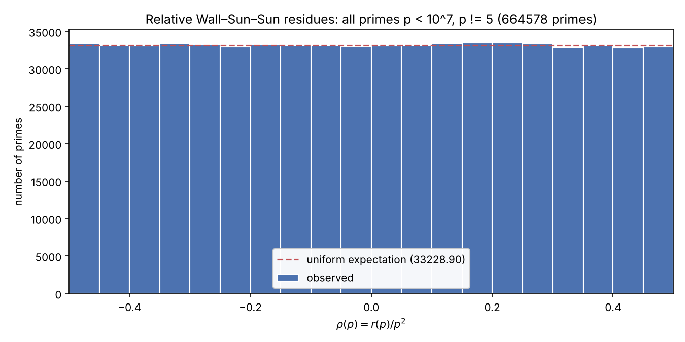
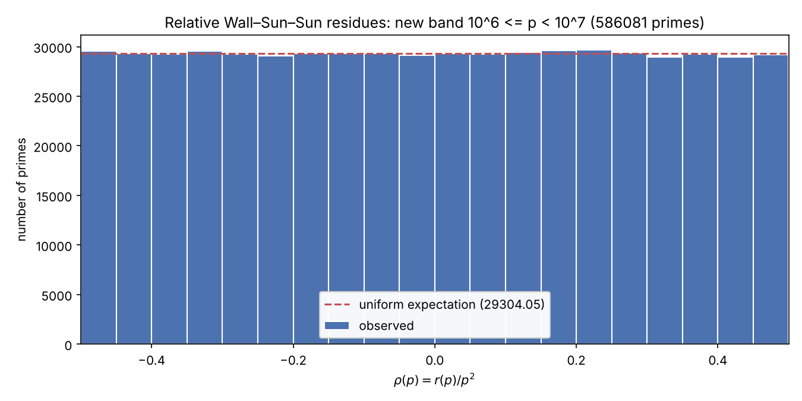
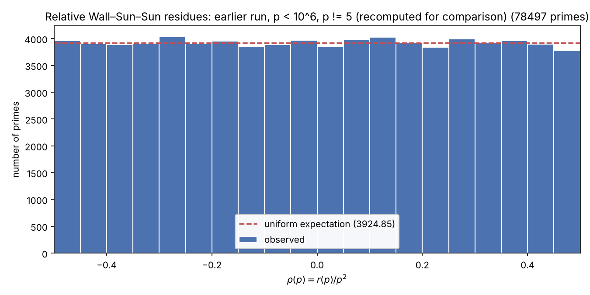

# Wall–Sun–Sun residues for primes p < 10,000,000

Convention: F_1 = F_2 = 1. R(p) = F_{p−(5/p)} mod p², with (5/p) = +1 for p ≡ ±1 (mod 5) and −1 for p ≡ ±2 (mod 5). r(p) is the centred residue in (−p²/2, p²/2] and ρ(p) = r(p)/p². Every number below is read from `results.json`.

## Checks

- Test suite (`pytest tests`): **230 passed, 0 failed** (`230 passed in 53.68s`).
- Anchor p = 7: F_8 mod 49 = 21 (expected 21): holds.
- Anchor p = 11: F_10 mod 121 = 55 (expected 55): holds.
- Anchor p = 13: F_14 mod 169 = 39 (expected 39): holds.

## The search

- Primes checked: **664578** (every prime p < 10,000,000 except p = 5; the largest is 9999991).
- Any R(p) = 0: **no**. No Wall–Sun–Sun prime below 10,000,000.

## Small-|ρ| counts by range

The uniform expectation is (primes in range) × 2c. Because p always divides F_{p−(5/p)}, r(p) = q·p for an integer q, so ρ = q/p takes only p possible values. The discrete expectation is the sum over primes of #{q ≠ 0 : |q| < c·p} / p, which treats q as uniform over those p values and leaves out q = 0.

| range | primes | c | primes with abs(ρ) < c | uniform expectation | discrete expectation |
|---|---:|---:|---:|---:|---:|
| Full range: p < 10⁷ | 664578 | 0.01 | 13147 | 13291.560 | 13289.867 |
| Full range: p < 10⁷ | 664578 | 0.001 | 1328 | 1329.156 | 1328.002 |
| New band: 10⁶ ≤ p < 10⁷ | 586081 | 0.01 | 11624 | 11721.620 | 11721.466 |
| New band: 10⁶ ≤ p < 10⁷ | 586081 | 0.001 | 1188 | 1172.162 | 1172.008 |
| Earlier run: p < 10⁶ (recomputed) | 78497 | 0.01 | 1523 | 1569.940 | 1568.401 |
| Earlier run: p < 10⁶ (recomputed) | 78497 | 0.001 | 140 | 156.994 | 155.994 |

## Full range: p < 10⁷

664578 primes, from 2 to 9999991.

### Histogram of ρ (20 bins, each (lo, hi])



Uniform expectation per bin: 664578 / 20 = 33228.90.

| bin | lo | hi | count | uniform expectation |
|---:|---:|---:|---:|---:|
| 1 | -0.50 | -0.45 | 33500 | 33228.90 |
| 2 | -0.45 | -0.40 | 33207 | 33228.90 |
| 3 | -0.40 | -0.35 | 33126 | 33228.90 |
| 4 | -0.35 | -0.30 | 33495 | 33228.90 |
| 5 | -0.30 | -0.25 | 33263 | 33228.90 |
| 6 | -0.25 | -0.20 | 32993 | 33228.90 |
| 7 | -0.20 | -0.15 | 33287 | 33228.90 |
| 8 | -0.15 | -0.10 | 33179 | 33228.90 |
| 9 | -0.10 | -0.05 | 33199 | 33228.90 |
| 10 | -0.05 | +0.00 | 33092 | 33228.90 |
| 11 | +0.00 | +0.05 | 33137 | 33228.90 |
| 12 | +0.05 | +0.10 | 33226 | 33228.90 |
| 13 | +0.10 | +0.15 | 33457 | 33228.90 |
| 14 | +0.15 | +0.20 | 33538 | 33228.90 |
| 15 | +0.20 | +0.25 | 33517 | 33228.90 |
| 16 | +0.25 | +0.30 | 33382 | 33228.90 |
| 17 | +0.30 | +0.35 | 32906 | 33228.90 |
| 18 | +0.35 | +0.40 | 33216 | 33228.90 |
| 19 | +0.40 | +0.45 | 32861 | 33228.90 |
| 20 | +0.45 | +0.50 | 32997 | 33228.90 |

### The 20 primes with the smallest |ρ|

| rank | p | r(p) | ρ(p) |
|---:|---:|---:|---:|
| 1 | 1677209 | 1677209 | 5.962286e-07 |
| 2 | 3194629 | 15973145 | 1.565127e-06 |
| 3 | 508771 | 1017542 | 3.931042e-06 |
| 4 | 3812177 | 57182655 | 3.934760e-06 |
| 5 | 956569 | 3826276 | 4.181612e-06 |
| 6 | 2621779 | -36704906 | -5.339886e-06 |
| 7 | 2878847 | 46061552 | 5.557781e-06 |
| 8 | 4590643 | -146900576 | -6.970701e-06 |
| 9 | 123863 | -123863 | -8.073436e-06 |
| 10 | 2337539 | 49088319 | 8.983807e-06 |
| 11 | 5075669 | -243632112 | -9.456881e-06 |
| 12 | 9303137 | 874494878 | 1.010412e-05 |
| 13 | 5354681 | 294507455 | 1.027139e-05 |
| 14 | 768241 | -6145928 | -1.041340e-05 |
| 15 | 5798269 | 359492678 | 1.069285e-05 |
| 16 | 1293559 | -18109826 | -1.082285e-05 |
| 17 | 8041879 | 772020384 | 1.193751e-05 |
| 18 | 3915707 | 191869643 | 1.251370e-05 |
| 19 | 8520737 | -945801807 | -1.302704e-05 |
| 20 | 1022591 | 14316274 | 1.369071e-05 |

### Record minima of abs(ρ), as p increases from 2

| p | r(p) | ρ(p) | abs(ρ) |
|---:|---:|---:|---:|
| 2 | 2 | 5.000000e-01 | 5.000000e-01 |
| 3 | 3 | 3.333333e-01 | 3.333333e-01 |
| 13 | 39 | 2.307692e-01 | 2.307692e-01 |
| 17 | -17 | -5.882353e-02 | 5.882353e-02 |
| 41 | -82 | -4.878049e-02 | 4.878049e-02 |
| 101 | -404 | -3.960396e-02 | 3.960396e-02 |
| 163 | -489 | -1.840491e-02 | 1.840491e-02 |
| 223 | 669 | 1.345291e-02 | 1.345291e-02 |
| 251 | -251 | -3.984064e-03 | 3.984064e-03 |
| 733 | 733 | 1.364256e-03 | 1.364256e-03 |
| 1063 | -1063 | -9.407338e-04 | 9.407338e-04 |
| 27191 | 217528 | 2.942150e-04 | 2.942150e-04 |
| 77969 | 1169535 | 1.923842e-04 | 1.923842e-04 |
| 84299 | 842990 | 1.186254e-04 | 1.186254e-04 |
| 86813 | -260439 | -3.455704e-05 | 3.455704e-05 |
| 123863 | -123863 | -8.073436e-06 | 8.073436e-06 |
| 508771 | 1017542 | 3.931042e-06 | 3.931042e-06 |
| 1677209 | 1677209 | 5.962286e-07 | 5.962286e-07 |

## New band: 10⁶ ≤ p < 10⁷

586081 primes, from 1000003 to 9999991.

### Histogram of ρ (20 bins, each (lo, hi])



Uniform expectation per bin: 586081 / 20 = 29304.05.

| bin | lo | hi | count | uniform expectation |
|---:|---:|---:|---:|---:|
| 1 | -0.50 | -0.45 | 29535 | 29304.05 |
| 2 | -0.45 | -0.40 | 29303 | 29304.05 |
| 3 | -0.40 | -0.35 | 29234 | 29304.05 |
| 4 | -0.35 | -0.30 | 29584 | 29304.05 |
| 5 | -0.30 | -0.25 | 29227 | 29304.05 |
| 6 | -0.25 | -0.20 | 29076 | 29304.05 |
| 7 | -0.20 | -0.15 | 29330 | 29304.05 |
| 8 | -0.15 | -0.10 | 29322 | 29304.05 |
| 9 | -0.10 | -0.05 | 29310 | 29304.05 |
| 10 | -0.05 | +0.00 | 29125 | 29304.05 |
| 11 | +0.00 | +0.05 | 29290 | 29304.05 |
| 12 | +0.05 | +0.10 | 29246 | 29304.05 |
| 13 | +0.10 | +0.15 | 29428 | 29304.05 |
| 14 | +0.15 | +0.20 | 29606 | 29304.05 |
| 15 | +0.20 | +0.25 | 29677 | 29304.05 |
| 16 | +0.25 | +0.30 | 29385 | 29304.05 |
| 17 | +0.30 | +0.35 | 28977 | 29304.05 |
| 18 | +0.35 | +0.40 | 29251 | 29304.05 |
| 19 | +0.40 | +0.45 | 28964 | 29304.05 |
| 20 | +0.45 | +0.50 | 29211 | 29304.05 |

### The 20 primes with the smallest |ρ|

| rank | p | r(p) | ρ(p) |
|---:|---:|---:|---:|
| 1 | 1677209 | 1677209 | 5.962286e-07 |
| 2 | 3194629 | 15973145 | 1.565127e-06 |
| 3 | 3812177 | 57182655 | 3.934760e-06 |
| 4 | 2621779 | -36704906 | -5.339886e-06 |
| 5 | 2878847 | 46061552 | 5.557781e-06 |
| 6 | 4590643 | -146900576 | -6.970701e-06 |
| 7 | 2337539 | 49088319 | 8.983807e-06 |
| 8 | 5075669 | -243632112 | -9.456881e-06 |
| 9 | 9303137 | 874494878 | 1.010412e-05 |
| 10 | 5354681 | 294507455 | 1.027139e-05 |
| 11 | 5798269 | 359492678 | 1.069285e-05 |
| 12 | 1293559 | -18109826 | -1.082285e-05 |
| 13 | 8041879 | 772020384 | 1.193751e-05 |
| 14 | 3915707 | 191869643 | 1.251370e-05 |
| 15 | 8520737 | -945801807 | -1.302704e-05 |
| 16 | 1022591 | 14316274 | 1.369071e-05 |
| 17 | 9225079 | -1254610744 | -1.474242e-05 |
| 18 | 7125281 | -769530348 | -1.515730e-05 |
| 19 | 2043869 | -67447677 | -1.614585e-05 |
| 20 | 4790483 | 378448157 | 1.649103e-05 |

### Record minima of abs(ρ), as p increases from 1000003

| p | r(p) | ρ(p) | abs(ρ) |
|---:|---:|---:|---:|
| 1000003 | -343228029681 | -3.432260e-01 | 3.432260e-01 |
| 1000033 | -96891197304 | -9.688480e-02 | 9.688480e-02 |
| 1000183 | -1000183000 | -9.998170e-04 | 9.998170e-04 |
| 1001197 | 501599697 | 5.004010e-04 | 5.004010e-04 |
| 1001831 | -342626202 | -3.413749e-04 | 3.413749e-04 |
| 1009007 | -215927498 | -2.120897e-04 | 2.120897e-04 |
| 1017391 | 137347785 | 1.326923e-04 | 1.326923e-04 |
| 1022591 | 14316274 | 1.369071e-05 | 1.369071e-05 |
| 1293559 | -18109826 | -1.082285e-05 | 1.082285e-05 |
| 1677209 | 1677209 | 5.962286e-07 | 5.962286e-07 |

## Earlier run: p < 10⁶ (recomputed)

78497 primes, from 2 to 999983.

### Histogram of ρ (20 bins, each (lo, hi])



Uniform expectation per bin: 78497 / 20 = 3924.85.

| bin | lo | hi | count | uniform expectation |
|---:|---:|---:|---:|---:|
| 1 | -0.50 | -0.45 | 3965 | 3924.85 |
| 2 | -0.45 | -0.40 | 3904 | 3924.85 |
| 3 | -0.40 | -0.35 | 3892 | 3924.85 |
| 4 | -0.35 | -0.30 | 3911 | 3924.85 |
| 5 | -0.30 | -0.25 | 4036 | 3924.85 |
| 6 | -0.25 | -0.20 | 3917 | 3924.85 |
| 7 | -0.20 | -0.15 | 3957 | 3924.85 |
| 8 | -0.15 | -0.10 | 3857 | 3924.85 |
| 9 | -0.10 | -0.05 | 3889 | 3924.85 |
| 10 | -0.05 | +0.00 | 3967 | 3924.85 |
| 11 | +0.00 | +0.05 | 3847 | 3924.85 |
| 12 | +0.05 | +0.10 | 3980 | 3924.85 |
| 13 | +0.10 | +0.15 | 4029 | 3924.85 |
| 14 | +0.15 | +0.20 | 3932 | 3924.85 |
| 15 | +0.20 | +0.25 | 3840 | 3924.85 |
| 16 | +0.25 | +0.30 | 3997 | 3924.85 |
| 17 | +0.30 | +0.35 | 3929 | 3924.85 |
| 18 | +0.35 | +0.40 | 3965 | 3924.85 |
| 19 | +0.40 | +0.45 | 3897 | 3924.85 |
| 20 | +0.45 | +0.50 | 3786 | 3924.85 |

### The 20 primes with the smallest |ρ|

| rank | p | r(p) | ρ(p) |
|---:|---:|---:|---:|
| 1 | 508771 | 1017542 | 3.931042e-06 |
| 2 | 956569 | 3826276 | 4.181612e-06 |
| 3 | 123863 | -123863 | -8.073436e-06 |
| 4 | 768241 | -6145928 | -1.041340e-05 |
| 5 | 533063 | 6396756 | 2.251141e-05 |
| 6 | 86813 | -260439 | -3.455704e-05 |
| 7 | 983299 | -42281857 | -4.373034e-05 |
| 8 | 657257 | 23003995 | 5.325162e-05 |
| 9 | 824779 | -36290276 | -5.334762e-05 |
| 10 | 169627 | 1865897 | 6.484817e-05 |
| 11 | 842587 | -48027459 | -6.764880e-05 |
| 12 | 171641 | 2402974 | 8.156559e-05 |
| 13 | 561931 | -35963584 | -1.138930e-04 |
| 14 | 200797 | 4618331 | 1.145435e-04 |
| 15 | 712693 | 58440826 | 1.150566e-04 |
| 16 | 378503 | -16654132 | -1.162474e-04 |
| 17 | 84299 | 842990 | 1.186254e-04 |
| 18 | 513841 | -32885824 | -1.245521e-04 |
| 19 | 526283 | 42102640 | 1.520095e-04 |
| 20 | 539207 | 44754181 | 1.539298e-04 |

### Record minima of abs(ρ), as p increases from 2

| p | r(p) | ρ(p) | abs(ρ) |
|---:|---:|---:|---:|
| 2 | 2 | 5.000000e-01 | 5.000000e-01 |
| 3 | 3 | 3.333333e-01 | 3.333333e-01 |
| 13 | 39 | 2.307692e-01 | 2.307692e-01 |
| 17 | -17 | -5.882353e-02 | 5.882353e-02 |
| 41 | -82 | -4.878049e-02 | 4.878049e-02 |
| 101 | -404 | -3.960396e-02 | 3.960396e-02 |
| 163 | -489 | -1.840491e-02 | 1.840491e-02 |
| 223 | 669 | 1.345291e-02 | 1.345291e-02 |
| 251 | -251 | -3.984064e-03 | 3.984064e-03 |
| 733 | 733 | 1.364256e-03 | 1.364256e-03 |
| 1063 | -1063 | -9.407338e-04 | 9.407338e-04 |
| 27191 | 217528 | 2.942150e-04 | 2.942150e-04 |
| 77969 | 1169535 | 1.923842e-04 | 1.923842e-04 |
| 84299 | 842990 | 1.186254e-04 | 1.186254e-04 |
| 86813 | -260439 | -3.455704e-05 | 3.455704e-05 |
| 123863 | -123863 | -8.073436e-06 | 8.073436e-06 |
| 508771 | 1017542 | 3.931042e-06 | 3.931042e-06 |

## Reproduce

```
pip install matplotlib pytest
python run_search.py   # writes results.json and the histogram PNGs
python make_report.py  # runs pytest, adds the pass count to results.json, writes REPORT.md
```
