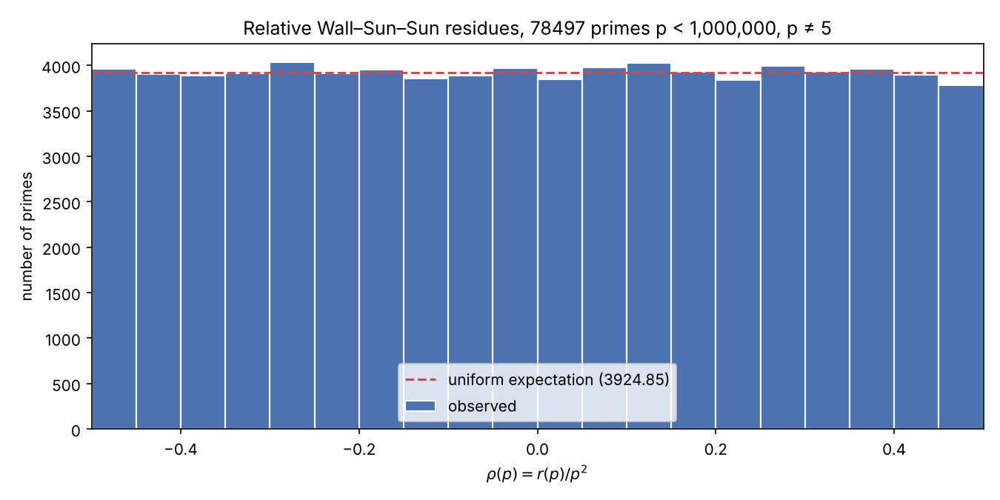

# Wall–Sun–Sun residues for primes p < 1,000,000

Convention: F_1 = F_2 = 1. R(p) = F_{p−(5/p)} mod p², with (5/p) = +1 for p ≡ ±1 (mod 5) and −1 for p ≡ ±2 (mod 5). Every number below is read from `results.json`.

## Checks

- Test suite (`pytest tests`): **226 passed, 0 failed** (`226 passed in 2.89s`).
- Anchor p = 7: F_8 mod 49 = 21 (expected 21): holds.
- Anchor p = 11: F_10 mod 121 = 55 (expected 55): holds.
- Anchor p = 13: F_14 mod 169 = 39 (expected 39): holds.

## Part 1: the search

- Primes checked: **78497** (every prime p < 1,000,000 except p = 5; the largest is 999983).
- Any R(p) = 0: **no**. No Wall–Sun–Sun prime below 1,000,000.

## Part 2: the residues

r(p) is the centred residue in (−p²/2, p²/2] and ρ(p) = r(p)/p². Because p always divides F_{p−(5/p)}, r(p) is a multiple of p, so ρ(p) = q/p for an integer q, the centred Fibonacci quotient.

### 1. Histogram of ρ (20 bins, each (lo, hi])



Uniform-heuristic expectation per bin: 78497 / 20 = 3924.85.

| bin | lo | hi | count | uniform expectation |
|---:|---:|---:|---:|---:|
| 1 | -0.50 | -0.45 | 3965 | 3924.85 |
| 2 | -0.45 | -0.40 | 3904 | 3924.85 |
| 3 | -0.40 | -0.35 | 3892 | 3924.85 |
| 4 | -0.35 | -0.30 | 3911 | 3924.85 |
| 5 | -0.30 | -0.25 | 4036 | 3924.85 |
| 6 | -0.25 | -0.20 | 3917 | 3924.85 |
| 7 | -0.20 | -0.15 | 3957 | 3924.85 |
| 8 | -0.15 | -0.10 | 3857 | 3924.85 |
| 9 | -0.10 | -0.05 | 3889 | 3924.85 |
| 10 | -0.05 | +0.00 | 3967 | 3924.85 |
| 11 | +0.00 | +0.05 | 3847 | 3924.85 |
| 12 | +0.05 | +0.10 | 3980 | 3924.85 |
| 13 | +0.10 | +0.15 | 4029 | 3924.85 |
| 14 | +0.15 | +0.20 | 3932 | 3924.85 |
| 15 | +0.20 | +0.25 | 3840 | 3924.85 |
| 16 | +0.25 | +0.30 | 3997 | 3924.85 |
| 17 | +0.30 | +0.35 | 3929 | 3924.85 |
| 18 | +0.35 | +0.40 | 3965 | 3924.85 |
| 19 | +0.40 | +0.45 | 3897 | 3924.85 |
| 20 | +0.45 | +0.50 | 3786 | 3924.85 |

### 2. The 20 primes with the smallest |ρ|

| rank | p | r(p) | ρ(p) |
|---:|---:|---:|---:|
| 1 | 508771 | 1017542 | 3.931042e-06 |
| 2 | 956569 | 3826276 | 4.181612e-06 |
| 3 | 123863 | -123863 | -8.073436e-06 |
| 4 | 768241 | -6145928 | -1.041340e-05 |
| 5 | 533063 | 6396756 | 2.251141e-05 |
| 6 | 86813 | -260439 | -3.455704e-05 |
| 7 | 983299 | -42281857 | -4.373034e-05 |
| 8 | 657257 | 23003995 | 5.325162e-05 |
| 9 | 824779 | -36290276 | -5.334762e-05 |
| 10 | 169627 | 1865897 | 6.484817e-05 |
| 11 | 842587 | -48027459 | -6.764880e-05 |
| 12 | 171641 | 2402974 | 8.156559e-05 |
| 13 | 561931 | -35963584 | -1.138930e-04 |
| 14 | 200797 | 4618331 | 1.145435e-04 |
| 15 | 712693 | 58440826 | 1.150566e-04 |
| 16 | 378503 | -16654132 | -1.162474e-04 |
| 17 | 84299 | 842990 | 1.186254e-04 |
| 18 | 513841 | -32885824 | -1.245521e-04 |
| 19 | 526283 | 42102640 | 1.520095e-04 |
| 20 | 539207 | 44754181 | 1.539298e-04 |

### 3. Record minima of |ρ| as p increases

| p | r(p) | ρ(p) | abs(ρ) |
|---:|---:|---:|---:|
| 2 | 2 | 5.000000e-01 | 5.000000e-01 |
| 3 | 3 | 3.333333e-01 | 3.333333e-01 |
| 13 | 39 | 2.307692e-01 | 2.307692e-01 |
| 17 | -17 | -5.882353e-02 | 5.882353e-02 |
| 41 | -82 | -4.878049e-02 | 4.878049e-02 |
| 101 | -404 | -3.960396e-02 | 3.960396e-02 |
| 163 | -489 | -1.840491e-02 | 1.840491e-02 |
| 223 | 669 | 1.345291e-02 | 1.345291e-02 |
| 251 | -251 | -3.984064e-03 | 3.984064e-03 |
| 733 | 733 | 1.364256e-03 | 1.364256e-03 |
| 1063 | -1063 | -9.407338e-04 | 9.407338e-04 |
| 27191 | 217528 | 2.942150e-04 | 2.942150e-04 |
| 77969 | 1169535 | 1.923842e-04 | 1.923842e-04 |
| 84299 | 842990 | 1.186254e-04 | 1.186254e-04 |
| 86813 | -260439 | -3.455704e-05 | 3.455704e-05 |
| 123863 | -123863 | -8.073436e-06 | 8.073436e-06 |
| 508771 | 1017542 | 3.931042e-06 | 3.931042e-06 |

### 4. Small-|ρ| counts

Expectation under the uniform heuristic = primes checked × 2c.

| threshold c | primes with abs(ρ) < c | uniform expectation |
|---:|---:|---:|
| 0.01 | 1523 | 1569.940 |
| 0.001 | 140 | 156.994 |

## Reproduce

```
pip install matplotlib pytest
python run_search.py   # writes results.json, rho_histogram.png
python make_report.py  # runs pytest, adds the pass count to results.json, writes REPORT.md
```
